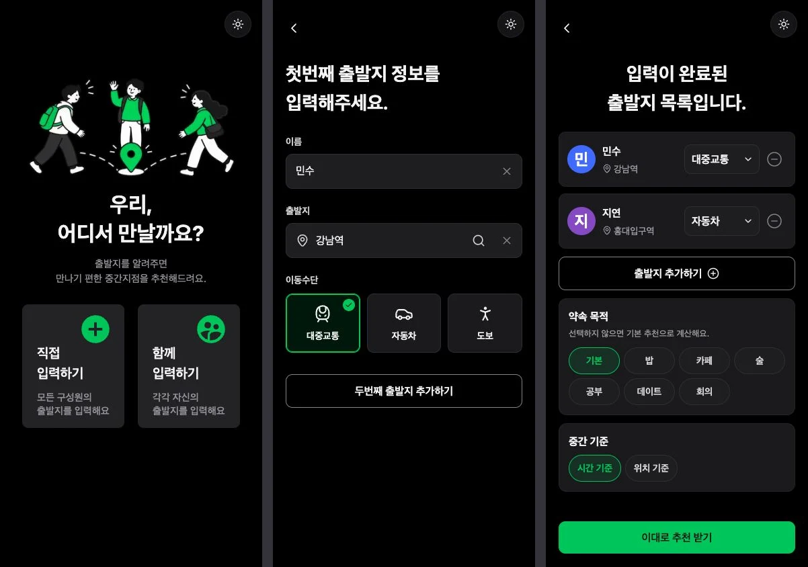
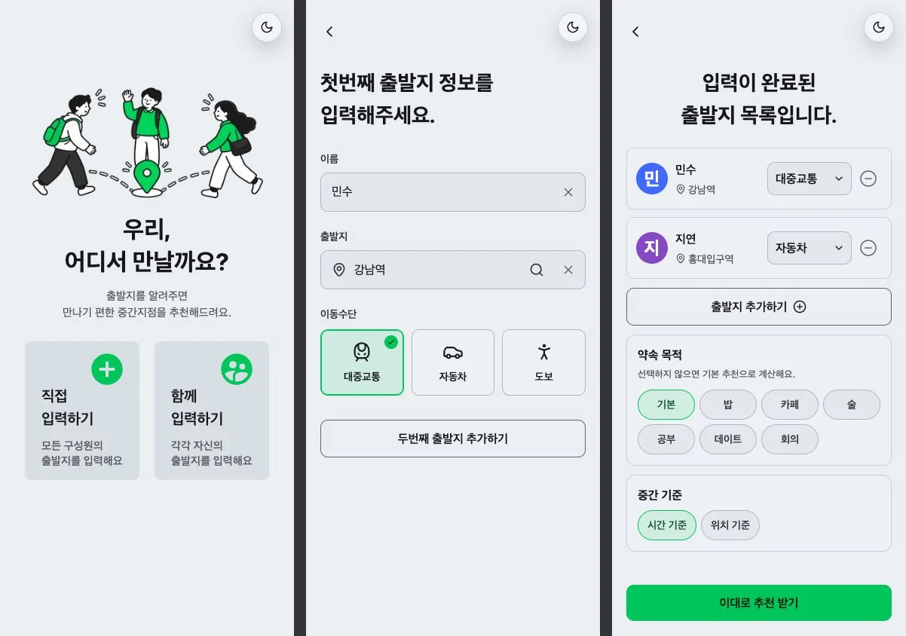

# 홈·출발지 입력·친구 목록 디자인 검증

검증일: 2026-10-28.

기존 색감, 글꼴, 두 가지 입력 방식과 추천 흐름을 유지하면서 홈 소개와 입력·목록의 크기, 정렬, 조작 방식을 개선했다. 결과 화면과 추천 알고리즘은 이번 변경에 포함하지 않는다.

## 화면

왼쪽부터 홈, 출발지 입력, 친구 목록이다. 각 화면은 390 × 844 CSS 픽셀로 캡처했다. 입력·목록의 이름과 주소는 UI 검증용 예시이며 실제 사용자 정보가 아니다.

홈은 실제 Next 앱을 캡처했다. 값이 채워진 입력·목록은 같은 소스 컴포넌트와 provider, layout을 사용하는 격리된 검증 화면을 캡처했다. 주소 서비스 응답과 라우터 연결만 대체했고 외부 서버 요청은 차단했다. 실제 Next 앱의 개인 입력, 함께 입력, 빈 목록도 별도로 확인했다.

## 확인한 동작

- 홈의 두 카드는 클릭과 키보드로 각각 개인 입력과 함께 입력 화면을 연다.
- 이름·출발지 레이블은 입력 후에도 보인다. 입력값 지우기는 등록 버튼을 비활성화하며 주소 검색을 다시 열지 않는다. 키보드로 이름을 지우면 입력칸으로, 출발지를 지우면 주소 선택 버튼으로 포커스가 돌아온다.
- 이동수단은 방향키로 선택할 수 있고 선택 상태와 키보드 포커스를 표시한다.
- 첫 사람 등록 후 폼이 초기화되고, 두 번째 등록 후 목록에 각각의 이동수단이 유지된다.
- 목록에서 한 사람의 이동수단을 바꿔도 다른 사람의 선택은 유지된다.
- 약속 목적과 중간 기준 선택, 친구 삭제, 두 명 미만일 때 추천 비활성화와 안내를 확인했다.
- 참가자가 없는 목록은 출발지 추가를 안내한다.

## 화면 크기와 접근성

- 390 × 844의 다크·라이트 모드, 320 × 568의 작은 화면, 1440 × 900의 데스크톱을 확인했다.
- 320px에서도 가로 넘침이 없고 일반적인 역명은 두 줄로 읽을 수 있다. 긴 목록은 세로로 스크롤하며 추천 버튼에 접근할 수 있다.
- 짧은 모바일 화면에서 입력 버튼이 첫 화면에 들어오도록 간격을 조정했다.
- 기존 컬러 아바타와 화면별 제목을 유지했다. 뒤로가기, 삭제, 입력값 지우기는 이름이 있는 버튼으로 제공한다.
- 입력과 네이티브 드롭다운의 글자는 16px이다. 이름 입력에 걸리던 축소를 해당 필드에서만 해제했다.
- 라이트 모드에서도 뒤로가기와 키보드 포커스가 보이도록 기존 테마 색상에서 색을 계산했다.
- 홈 그림은 투명 배경 WebP이며 1020 × 510, 약 77 KiB다. 장식 이미지로 처리하고 공간을 미리 확보한다.

## 자동 검증

PR 준비 시 `pnpm agent:harness` 전체 검증을 실행했고 통과했다.

| 검사                                  | 결과      |
| ------------------------------------- | --------- |
| 정적 계약 검사                        | 통과      |
| 앱·RPC 회귀 테스트                    | 20개 통과 |
| ESLint                                | 통과      |
| 프로덕션 빌드와 빌드 내 타입 검사     | 통과      |
| Edge Function 4개 및 테스트 타입 검사 | 통과      |
| Edge Function 라이브러리·계약 테스트  | 41개 통과 |

변경 파일의 Prettier 검사와 `git diff --check`도 통과했다. 기존 테스트의 의도적인 오류 로그와 DOM 없는 환경에서의 경고는 테스트 실패가 아니다.

## 검증 한계

- 로컬 API 환경 설정이 없어 실제 카카오 주소 조회, 경로 조회와 추천 생성은 검증하지 않았다. 라이브 다중 사용자 방도 새로 만들지 않았다. 기존 공유방 회귀 테스트는 통과했다.
- 별도로 실행한 `tsc --noEmit`은 기존 `tests/search-storage.test.tsx:39`의 ES5 블록 내부 함수 선언 오류를 보고했다. 해당 테스트는 이번 PR에서 변경하지 않았다. 이 독립 명령이 통과했다고 간주하지 않는다.
- 검증용 주소 응답과 라우터 대체 코드는 앱에 포함하지 않는다. 새 환경 변수, API 변경, 마이그레이션, 패키지 추가가 없다.
